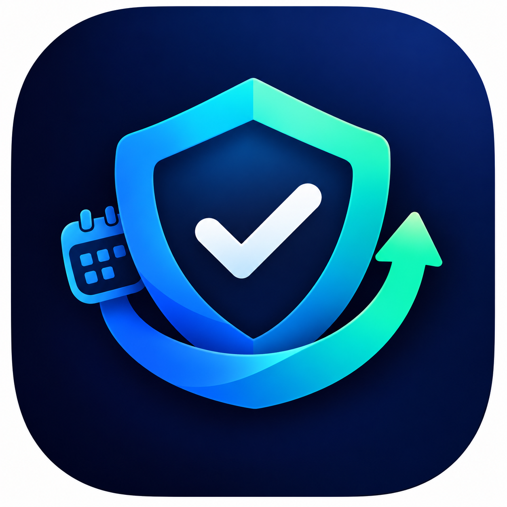
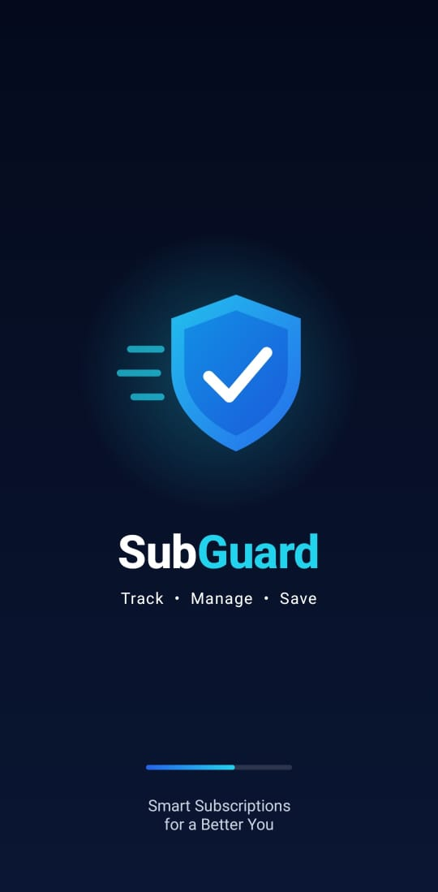
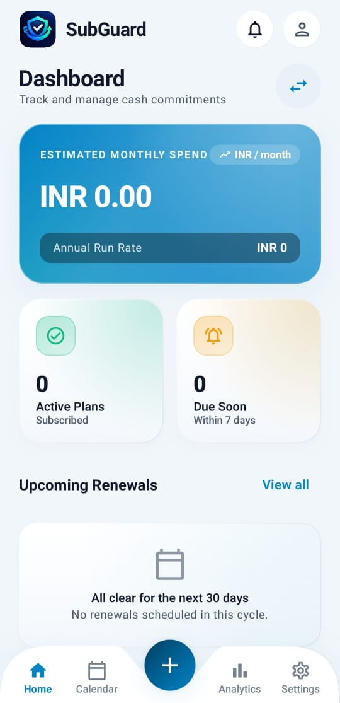
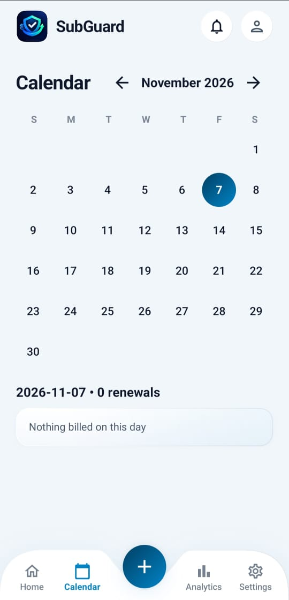
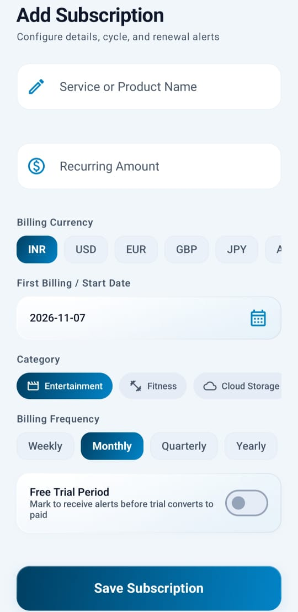
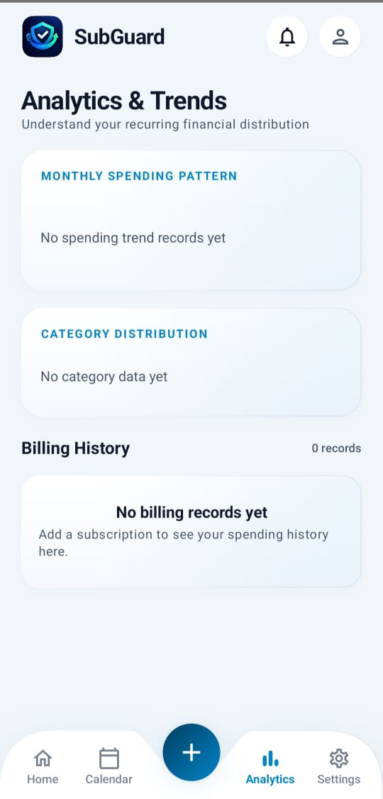
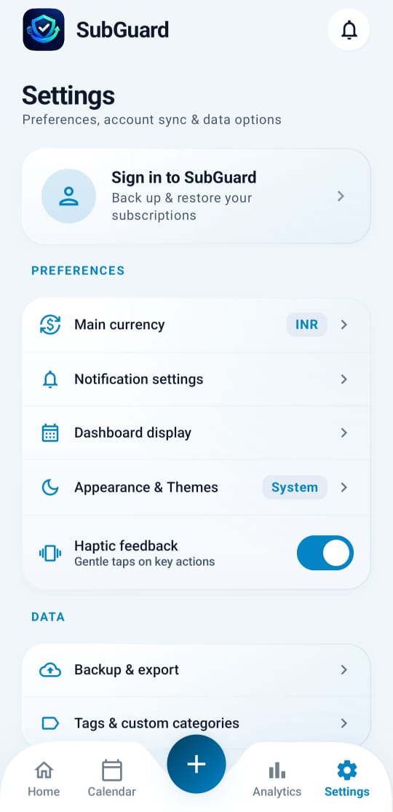

<p align="center">
  
</p>

# SubGuard

Smart recurring subscription and renewal tracker for Android, built with Kotlin and Jetpack Compose.

SubGuard helps you keep track of all your subscriptions in one place, see where your money goes, and never miss a renewal date.

## Features

- Track recurring subscriptions with categories and tags
- Dashboard and spending analytics
- Calendar view of upcoming renewals
- Renewal reminders through notifications
- Multiple currencies with a built-in currency converter
- Backup and CSV export
- Appearance settings with light and dark themes
- Guest mode, with your data migrated when you create an account
- Sign-in with email verification (Firebase Authentication)

## Screenshots

<table>
  <tr>
    <td align="center"><br>Splash Screen</td>
    <td align="center"><br>Dashboard</td>
    <td align="center"><br>Calendar</td>
  </tr>
  <tr>
    <td align="center"><br>Add Subscription</td>
    <td align="center"><br>Analytics &amp; Trends</td>
    <td align="center"><br>Settings</td>
  </tr>
</table>

## Tech stack

- Kotlin
- Jetpack Compose and Material 3
- MVVM architecture (ViewModels and repositories)
- Firebase Authentication and Cloud Firestore
- Gradle Kotlin DSL with a version catalog

## Project structure

A simplified view of the main folders:

```
SubGuard-app/
├── app/
│   └── src/
│       ├── main/
│       │   ├── java/com/davinder/subguard/
│       │   │   ├── data/
│       │   │   │   ├── auth/
│       │   │   │   ├── firebase/     # Firebase Auth manager, Firestore collection names, user session
│       │   │   │   ├── local/        # Guest-mode stores, guest data migration, app preferences
│       │   │   │   ├── model/
│       │   │   │   ├── remote/       # Currency API service
│       │   │   │   └── repository/
│       │   │   ├── notification/
│       │   │   ├── ui/
│       │   │   │   ├── analytics/
│       │   │   │   ├── components/
│       │   │   │   ├── navigation/
│       │   │   │   ├── screens/      # One folder per screen (dashboard, calendar, settings, ...)
│       │   │   │   └── theme/
│       │   │   ├── util/             # App links, cancel guide, category colors, CSV export, date and profile helpers
│       │   │   └── viewmodel/
│       │   ├── res/
│       │   └── AndroidManifest.xml
│       └── test/
├── docs/
│   └── screenshots/                  # App screenshots used in this README
├── gradle/
├── build.gradle.kts
└── settings.gradle.kts
```
## Download

- Latest APK: see the [subguard-releases](https://github.com/dsrolly/subguard-releases) repository
- Web app: https://subguard-265d6.web.app

## Run the project locally

The Firebase configuration file is not included in this repository, so you need to connect your own Firebase project:

1. Clone this repository and open it in Android Studio.
2. Create a project in the [Firebase console](https://console.firebase.google.com/).
3. Add an Android app with the package name `com.davinder.subguard`.
4. Enable Authentication and Cloud Firestore for the project.
5. Download `google-services.json` and place it in the `app/` folder. The file `app/google-services.json.example` shows the expected structure.
6. Sync Gradle and run the app.

`google-services.json` is listed in `.gitignore`, so it will not be committed by accident.

## Author

Built by Rolly ([@dsrolly](https://github.com/dsrolly)) as part of my MCA studies at Punjabi University, Patiala.
LinkedIn: https://www.linkedin.com/in/dsrolly
